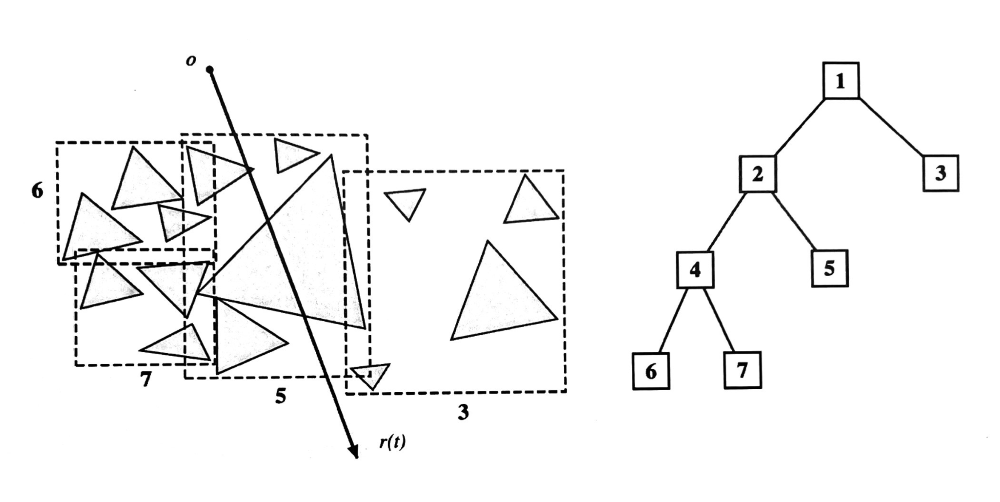

# Midterm Examination

This exam is divided into four sections: True or False Questions, Multiple Select Questions, Short Answer Questions and Derivation Questions. The total score for this exam is 100 points.

## 1 True or False Questions (21 pts)

Each question in this section is worth 3 points. 3 points for a correct answer, 0 points for no answer, and 3 points deducted for an incorrect answer. Simply answer T/F; no explanation is required.

1. The order of composition of affine transformations does not affect the final transformation.
2. A mesh is a Manifold mesh if and only if each edge is incident to one or two faces.
3. Each 3D rotation corresponds to exactly one unit quaternion.
4. One key idea of PointNet is to ensure that the model is permutation invariant to the input point cloud (which means changing the order of the points does not affect the output).
5. A point cloud explicitly encodes the connectivity and topology between its points.
6. In Multisample Anti-Aliasing (MSAA), multiple samples are used to determine pixel coverage, but shading is performed only once per pixel.
7. Trilinear interpolation first performs bilinear interpolation, and then performs linear interpolation between the two results.

## 2 Multiple Select Questions (48 pts)

Each question in this section is worth 6 points. Select all correct answers (at least one) for full marks. The number of correct answers is not specified for any question.

1. A cubic Bézier curve $B(t), t \in [0,1]$ has control points $P_0 = (0, 0), P_1 = (0, 2), P_2 = (2, 2),$ and $P_3 = (2, 0)$. Which statements are correct?
   - (A) $B(\frac{1}{2}) = (1, \frac{3}{2})$. 
   - (B) $B'(0) = (0, 2)$.
   - (C) $B'(1) = (0, -6)$.
   - (D) The curve passes through $P_1$.

2. Consider one Loop subdivision step on a triangle mesh without boundary. Which statements are correct?
   - (A) Every original vertex keeps its position.
   - (B) The new vertex on edge $AB$, whose two adjacent triangles have opposite vertices $C$ and $D$, is placed at $\frac{3}{8}(A + B) + \frac{1}{8}(C + D)$.
   - (C) Every face of the resulting mesh is a quadrilateral.
   - (D) An original vertex that equals the average of its neighboring vertices keeps its position after the update.

3. Use homogeneous column vectors in 2D. Let $T$ translate by $(1, 2)$, let $R$ rotate counterclockwise by $90^{\circ}$ about the origin, and let $M=TR$. Which statements are correct?
   - (A) $M(1, 0, 1)^{\top} = (1, 3, 1)^{\top}$.
   - (B) $M(1, 0, 0)^{\top} = (1, 3, 0)^{\top}$.
   - (C) $M^{-1} = R^{-1}T^{-1}$.
   - (D) $M$ preserves the Euclidean distance between any two points.

4. Which statements about learning from voxel grids and point clouds are correct?
   - (A) Doubling the resolution along each axis of a dense cubic voxel grid doubles its number of voxels.
   - (B) Sparse convolution can reduce computation by exploiting the sparsity of occupied voxels.
   - (C) PointNet++ builds a feature hierarchy by applying PointNet to local regions.
   - (D) Standard PointNet explicitly aggregates a local neighborhood around each point before global pooling.

5. A white triangle (intensity 1) is rasterized against a black background (intensity 0). In a $4 \times 4$ supersampling estimate for one pixel, 6 of the 16 equally weighted samples lie inside the triangle. Which statements are correct?
   - (A) The estimated pixel intensity is $\frac{3}{8}$.
   - (B) The triangle must cover exactly $\frac{3}{8}$ of the pixel's area.
   - (C) Low-pass filtering before sampling can reduce aliasing.
   - (D) Convolution in the spatial domain corresponds to pointwise multiplication in the frequency domain.

6. Which statements about Blinn-Phong lighting and shading interpolation are correct?
   - (A) With the light, surface point, material, and normal fixed, changing only the viewing direction leaves the Lambertian diffuse term unchanged.
   - (B) Increasing the Blinn-Phong specular exponent makes the specular highlight broader.
   - (C) Gouraud shading interpolates vertex normals and evaluates the lighting model at each pixel.
   - (D) Phong shading interpolates vertex normals and evaluates the lighting model at each pixel.

7. For a ray $r(t) = o + td, t \ge 0$, the slab method gives intervals $[-2, 4], [1, 3],$ and $[2, 5]$ for an axis-aligned bounding box. Which statements are correct?
   - (A) The box entry parameter is $t_{\text{enter}} = 1$.
   - (B) The ray lies inside the box for $2 \le t \le 3$.
   - (C) Intersecting the box guarantees an intersection with a triangle contained in it.
   - (D) If a ray misses a bounding box, intersection tests with all primitives fully contained in that box can be skipped.

8. Which statements about radiometry are correct? For (C) and (D), consider an isotropic point light source emitting total radiant flux $\Phi$, with polar angle $\theta$ measured from the positive $z$-axis and azimuth $\phi$.
   - (A) Irradiance is incident power per unit surface area, while radiance is power per unit projected area per unit solid angle.
   - (B) For incident radiance $L_i(p, \omega)$, irradiance is $E(p) = \int_{H^2} L_i(p, \omega) \mathrm{d}\omega$, where $H^2$ is the hemisphere above the surface at $p$.
   - (C) The radiant intensity in every direction is $I = \frac{\Phi}{4\pi}$.
   - (D) The radiant flux emitted into directions with $0 \le \theta \le \frac{\pi}{3}$ and $0 \le \phi < 2\pi$ is $\frac{\Phi}{4}$.

## 3 Short Answer Questions (21 pts)

1. (5 pts) What is a z-buffer? Explain how the z-buffer algorithm determines the visible surface at each pixel when rendering opaque triangles.
   
2. (8 pts) Mipmap helps reduce aliasing in texture minification, but it can also produce overly blurred results. Explain when this overblurring occurs. Describe the main idea of one method that reduces this problem.
   
3. (8 pts) Consider the 2D scene and its bounding volume hierarchy in Figure 3..
   
   (a) (4 pts) Briefly explain how a BVH is constructed from a set of triangles.
   
   (b) (4 pts) For the ray shown in the figure, list, in order, all nodes whose bounding boxes are tested for intersection with the ray. Use the node numbers. Assume a depth-first traversal and the left child is visited before the right child.

   

## 4 Derivation Questions (10 pts)

Derive the required expressions or formulas, providing a clear and logical sequence of steps.

1. Consider a triangle with three vertices $P_0, P_1, P_2 \in \mathbb{R}^3$. A point $X$ inside the triangle can be represented using barycentric coordinates:

   $$
   X = \alpha P_0 + \beta P_1 + \gamma P_2
   $$

   where

   $$
   \alpha + \beta + \gamma = 1
   $$

   (a) Define $v_0 = P_1 - P_0, v_1 = P_2 - P_0,$ and $v_2 = X - P_0$. Derive the expressions of the barycentric coordinates $\alpha, \beta, \gamma$ using dot products.

   (b) Suppose each vertex has an associated attribute $C_0, C_1, C_2$ (e.g., color or texture coordinates). Derive the interpolated attribute $C(X)$ at point $X$ using barycentric coordinates, and prove that this interpolation is linear with respect to the barycentric coordinates.